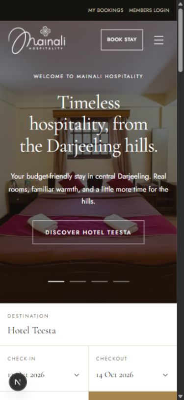
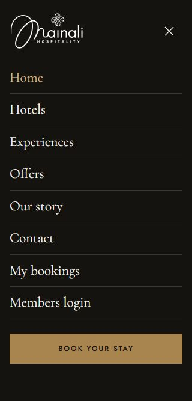
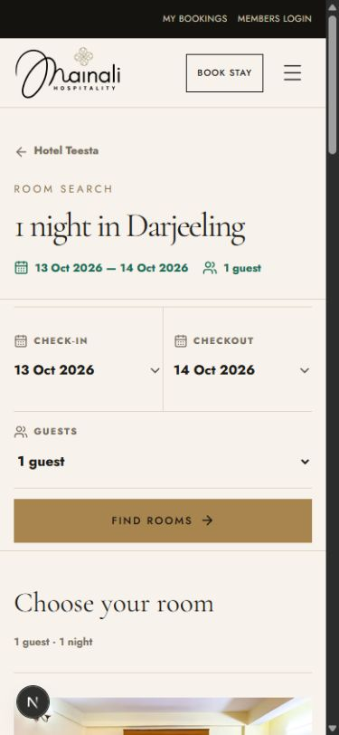
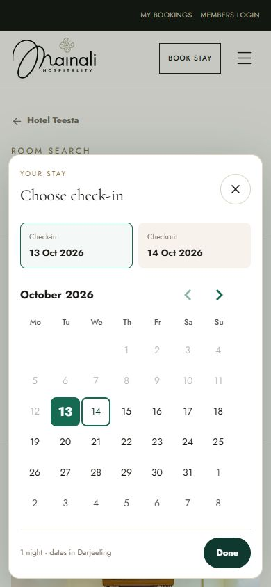
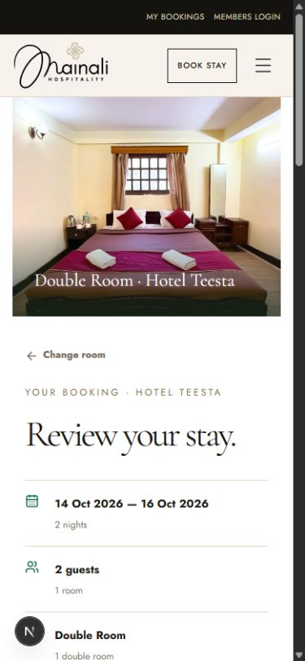
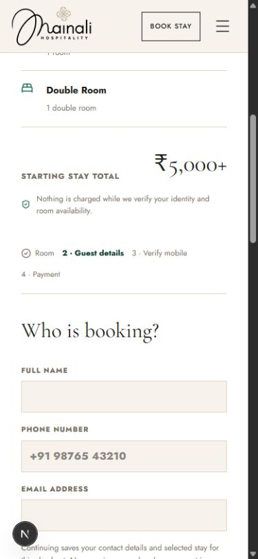
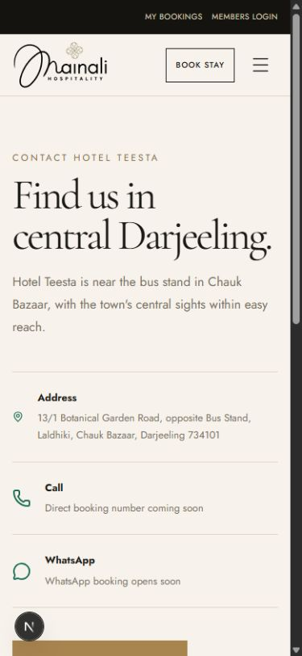
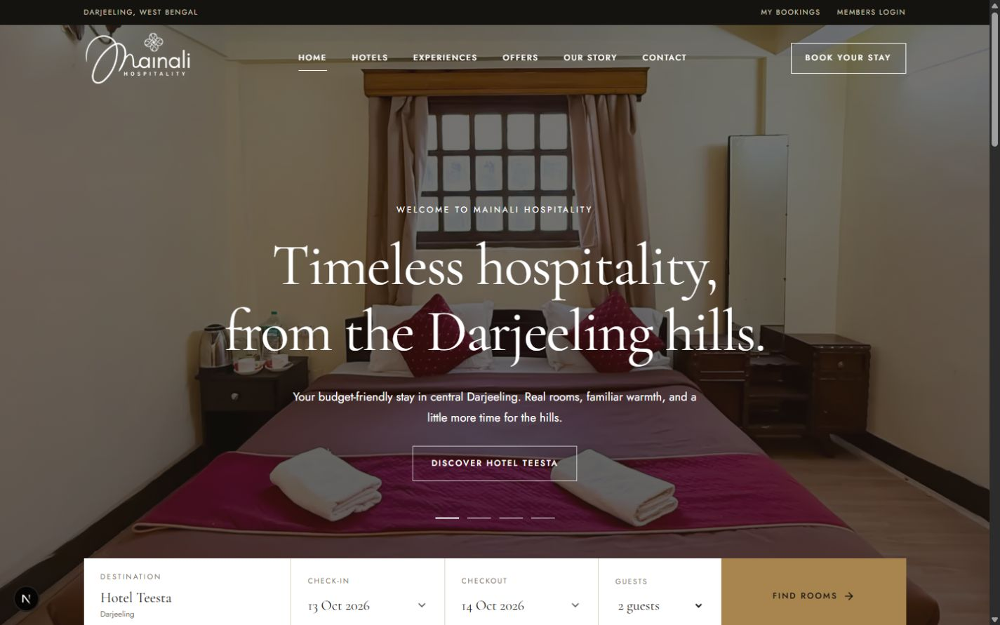

# Mainali Hospitality mobile review

Reviewed locally on 13 October 2026. Scope: homepage, mobile navigation, date selection, room results, booking review/guest form, and contact page. This is a review of the public browsing and booking-entry journey, not every route or a live reservation test.

## Implemented

- Used the supplied transparent `mainali work-02.png` without changing its artwork. The original black/gold logo appears on light surfaces; CSS renders a white version on dark surfaces.
- Replaced the text wordmark in the shared brand component, covering public header, menu, footer, and staff surfaces that use it.
- Updated public page titles, description, manifest, story, footer, property group name, and homepage welcome to Mainali Hospitality.
- Sized the logo fluidly for narrow phones and adjusted header height to preserve its proportions.
- Added a visible phone-header Book stay button; retained the full accessible name Book your stay.
- Shortened mobile menu rows while retaining at least 48px row targets. Added safe-area padding.
- Reduced mobile homepage hero height and room-search whitespace. Placed arrival/departure side by side, with a full-width search button.
- Tightened booking-entry spacing, kept guest inputs at 16px, expanded form buttons and footer link targets on phones.

## Reviewed steps

| Step | Surface | Health | Evidence |
| --- | --- | --- | --- |
| 1 | Homepage/header | Good after changes. Logo, menu and booking action fit. Real room photography anchors the page. | [Phone](04-home-after.png), [desktop](11-desktop-after.png) |
| 2 | Mobile navigation | Good. All links and booking action fit in the captured 320 × 667 menu. | [Menu](05-menu-320-after.png) |
| 3 | Calendar | Good at the tested phone size. Arrival selection advances to checkout; changed dates work in search. | [Calendar](07-calendar-after.png) |
| 4 | Room search/results | Improved. Date fields are side by side; results begin sooner. Changing to 14–16 October and two guests produced two nights and a ₹5,000+ Double Room total, with matching booking URL. On-request choices still need a usable enquiry path. | [Before](01-rooms-before.png), [after](06-rooms-after.png) |
| 5 | Booking review/guest form | Layout fits. Dates, party and room carry into review. Inputs render at 16px. Preview booking is incomplete beyond collecting details. | [Review](08-booking-after.png), [form](09-guest-form-after.png) |
| 6 | Contact | Needs action. Address is present, but Call and WhatsApp are placeholders. | [Contact](10-contact-after.png) |

## Highest-impact next improvements

1. **Give guests a usable enquiry path.** Add the owner's verified phone, WhatsApp and a directions link to Contact and on-request room cards. The Contact screenshot shows no usable call/WhatsApp action; room results offer several on-request categories.
2. **Match booking wording to preview capability.** The booking form shows Verify mobile and Payment steps while the homepage says confirmation/payments are not open. Until enabled, identify the journey clearly as an enquiry or stay request, and state when/how the hotel will respond.
3. **Make room comparison easier.** Room results show photos, capacity and starting prices, but guests must read paragraphs to compare rooms. Add owner-confirmed inclusions (for example bathroom, breakfast, Wi-Fi), bed arrangement and check-in/check-out times in short, consistent rows. Do not invent amenities or policies.
4. **Improve small supporting text.** The booking-step tracker, captions and fine print are visibly small on phones. Increase key instructions and pricing qualifications and test with larger system text. The logo's Hospitality lettering is also small at narrow widths; retain the accessible brand name.

## Validation and limits

- Homepage checked at 320, 390, 768 and 1440px viewport widths; menu at 320 × 667; room search at 320 and 390; booking review/form at 320 and 390; Contact at 390.
- Measured document scroll width equals document client width on the checked homepage, room-search and booking layouts: no document-level horizontal overflow in those states.
- Menu opens/closes; date changes and guest selection navigate to matching results; Double Room selection carries the stay into review.
- ESLint, TypeScript no-emit, production build and diff whitespace checks passed.
- No guest details were submitted, no draft was created and no payment was attempted. Auth, live availability, payment, screen-reader behavior, real-device keyboards, 200% zoom and contrast across every image were not comprehensively tested. These screenshots support the visible layout findings, not full accessibility certification.

## Screenshots

